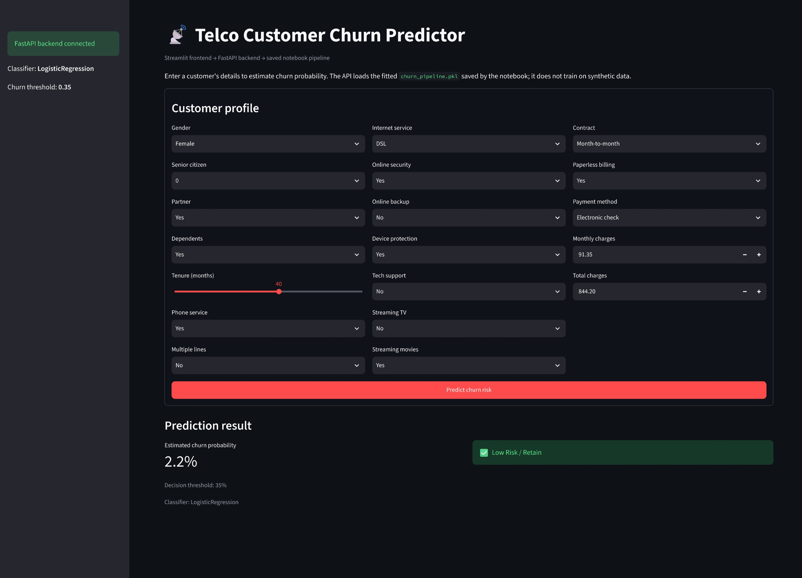

# Telco Customer Churn Prediction Using Classical Machine Learning

A machine learning application that predicts customer churn using a classical ML classification pipeline, served through a **FastAPI backend** and an interactive **Streamlit UI**.

## Application Preview



## Overview

Customer churn occurs when customers discontinue a company's services. Identifying customers who are likely to churn helps businesses develop targeted retention strategies and improve customer relationships.

This project combines data preprocessing, machine learning, model evaluation, and application deployment to demonstrate an end-to-end churn prediction workflow.

## Features

- **Data preprocessing:** Missing-value imputation, feature scaling, and categorical encoding.
- **Machine learning:** Logistic Regression classification pipeline.
- **Model persistence:** Save and load the trained pipeline using Joblib.
- **REST API:** Serve predictions through FastAPI.
- **Interactive UI:** Enter customer information and obtain churn predictions using Streamlit.
- **Modular architecture:** Separate model-serving and user-interface components.

## Tech Stack

| Category | Technologies |
|---|---|
| Language | Python |
| Data processing | Pandas, NumPy |
| Machine learning | Scikit-learn |
| Model persistence | Joblib |
| Backend | FastAPI, Uvicorn |
| Frontend | Streamlit |
| Development | Jupyter Notebook, VS Code |

## Project Structure

```text
Telco-Churn/
├── notebooks/
│   └── svmchurn.ipynb
├── main.py
├── app.py
├── requirements.txt
└── artifacts/
    └── churn_pipeline.pkl
```

- `notebooks/svmchurn.ipynb` — Model development, preprocessing, and evaluation.
- `main.py` — FastAPI backend for serving predictions.
- `app.py` — Streamlit interface.
- `requirements.txt` — Python dependencies.
- `artifacts/churn_pipeline.pkl` — Serialized preprocessing and model pipeline.

## Installation and Setup

### 1. Clone the repository

```bash
git clone https://github.com/amaan-ml-ds/Churn-Prediction-Using-Classical-Machine-Learning-with-Streamlit-Deployment.git
```

### 2. Navigate to the project directory

```bash
cd Churn-Prediction-Using-Classical-Machine-Learning-with-Streamlit-Deployment
```

If the project is inside a `Telco-Churn/` subdirectory, run:

```bash
cd Telco-Churn
```

### 3. Install dependencies

```bash
python -m pip install -r requirements.txt
```

### 4. Start the FastAPI backend

```bash
python -m uvicorn main:app --reload
```

The API should be available at:

- API: http://127.0.0.1:8000
- Interactive API documentation: http://127.0.0.1:8000/docs

Keep the backend running.

### 5. Launch the Streamlit application

Open a second terminal in the project directory and run:

```bash
python -m streamlit run app.py
```

Open the local URL displayed in the terminal, typically:

http://localhost:8501

## Model Pipeline

The application uses a scikit-learn pipeline to combine preprocessing and classification.

1. Handle missing numerical values using median imputation.
2. Scale numerical features using `StandardScaler`.
3. Handle missing categorical values using most-frequent imputation.
4. Encode categorical features using `OneHotEncoder`.
5. Generate churn predictions using Logistic Regression.

Keeping preprocessing and the estimator in a single pipeline helps ensure that inference uses the same transformations as training.

## Prediction Workflow

```text
Customer Input
      ↓
Streamlit User Interface
      ↓
FastAPI Prediction Endpoint
      ↓
Saved ML Pipeline
      ↓
Churn Prediction
      ↓
Prediction Displayed in UI
```

## Evaluation

Model performance should be assessed using metrics appropriate for an imbalanced classification problem:

- **Precision:** How many predicted churners actually churn.
- **Recall:** How many actual churners the model identifies.
- **F1-score:** Balance between precision and recall.
- **ROC-AUC:** Ability to distinguish between churn and non-churn customers.

Recall and precision are particularly important because failing to identify a customer at risk of churn can have a business cost, while incorrectly flagging a customer can waste retention resources.

## Future Improvements

- Hyperparameter tuning and cross-validation.
- Decision-threshold optimization based on business costs.
- Model monitoring and prediction logging.
- Automated testing and CI/CD.
- Docker-based deployment.
- Cloud deployment with production-grade configuration.

## Disclaimer

This project is intended for educational and portfolio purposes. Predictions are estimates based on the trained model and should not be treated as guarantees of customer behavior.

## Author

**Amaan**

GitHub: [@amaan-ml-ds](https://github.com/amaan-ml-ds)
